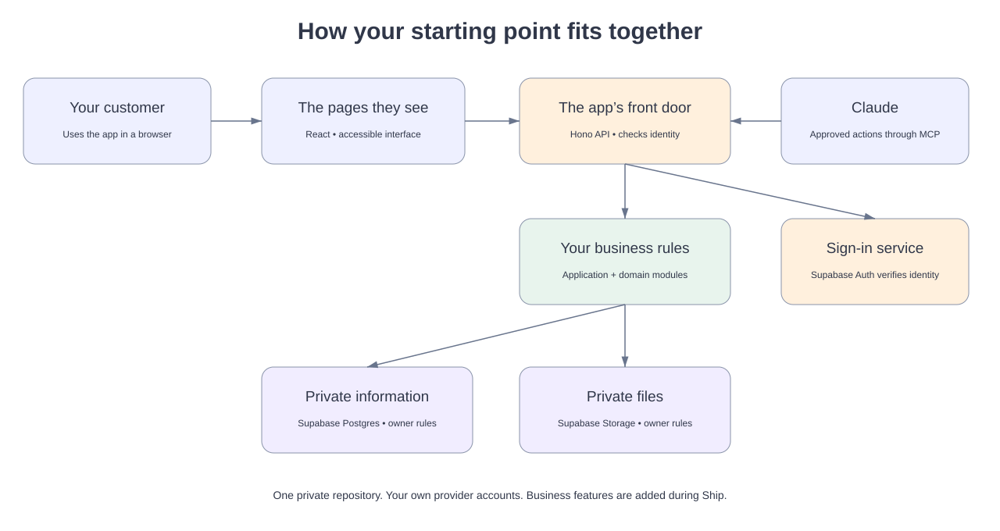

# Developing the base app

How the app is built, run and checked on your own computer. Founders on the course do not need this page: start at the [README](../README.md).

## Documentation

- [Documentation map](README.md).
- [Architecture and editable Excalidraw diagrams](architecture/001-foundation.md).
- [Branding](BRANDING.md), [adding capabilities](EXTENDING.md), and [recovery](RECOVERY.md).

## Try it locally

Install Node 22.19 or newer, pnpm 10.33.2, Docker Desktop and the Supabase CLI. Start Docker Desktop, then open a terminal in this folder.

```sh
pnpm install --frozen-lockfile
pnpm run doctor
supabase start
pnpm run setup
pnpm build
```

Keep two terminal tabs open:

```sh
pnpm dev:api
```

```sh
pnpm dev
```

Open **http://127.0.0.1:4310**. Select **Create a practice account**, enter a made-up email and a practice password of at least 12 characters. Local email confirmation is disabled only in the local Supabase configuration. No live email is sent.

Try adding your name, saving a practice file, downloading it, signing out and signing back in. The app uses the local database, identity service and private storage. Closing the browser does not erase saved work. The local email inbox at http://127.0.0.1:58324 lets you test password recovery.

The generated reviewer fixture under `.local/` is for automated tests. Do not share or commit that folder. Keep the API and Vite bound to loopback.

## Understand the pieces



The browser shows the pages. The API checks who is asking, then calls the right application action. The database and file store check ownership again. Claude uses a separate authenticated doorway to the same app.

[Edit the architecture in Excalidraw](architecture/how-the-app-works.excalidraw) by opening the file in Excalidraw. Also see the [code boundary diagram](architecture/dependency-boundaries.svg), its [editable source](architecture/dependency-boundaries.excalidraw) and the [architecture decision](architecture/001-foundation.md).

## Your first change

Ask Claude: “Change the welcome heading in the Overview screen to ‘A new beginning’. Show me the change, run the checks and let me review it locally.”

The current overview is in `apps/web/src/features/overview/Overview.tsx`. This is a wording change and needs no database or API modification. For a new capability, follow [the extension guide](EXTENDING.md). Make one small change, verify, click through, then decide whether to keep it.

## Check your work

```sh
pnpm exec playwright install chromium firefox webkit
pnpm verify
pnpm test:e2e
node scripts/integration.mjs
node scripts/performance.mjs
```

The ten-minute performance smoke runs locally and saves its receipt under `.local/`. The integration check creates and removes one synthetic account. The browser test creates and removes a synthetic file and changes the synthetic reviewer's display name.

For a deliberate reset of **all local practice data in this project**:

```sh
pnpm db:reset --confirm-local-reset
```

This is irreversible for local data. It cannot target hosted Supabase. Save anything you want to keep first.

## A second working copy on one computer

Founders take their copy on GitHub with **Use this template** (see the [README](../README.md)). `pnpm provision` is for a developer who wants another copy on the same computer, with its own local database and ports so the two do not collide:

```sh
pnpm provision /absolute/path/to/new-folder
```

It copies the commit you have checked out (or a tag, if you name one as a second argument), with no history, settings or data, starts a fresh Git history, records where it came from in `base-version.json`, installs the locked packages and runs the doctor. It refuses a folder that already exists. See [maintenance](MAINTAINER.md) and the [cost model](../COST-MODEL.md).

## What is deliberately absent

No recipe, community, billing, customer or sales features. Every business receives this same foundation, then adds what its own plan calls for during Ship.
