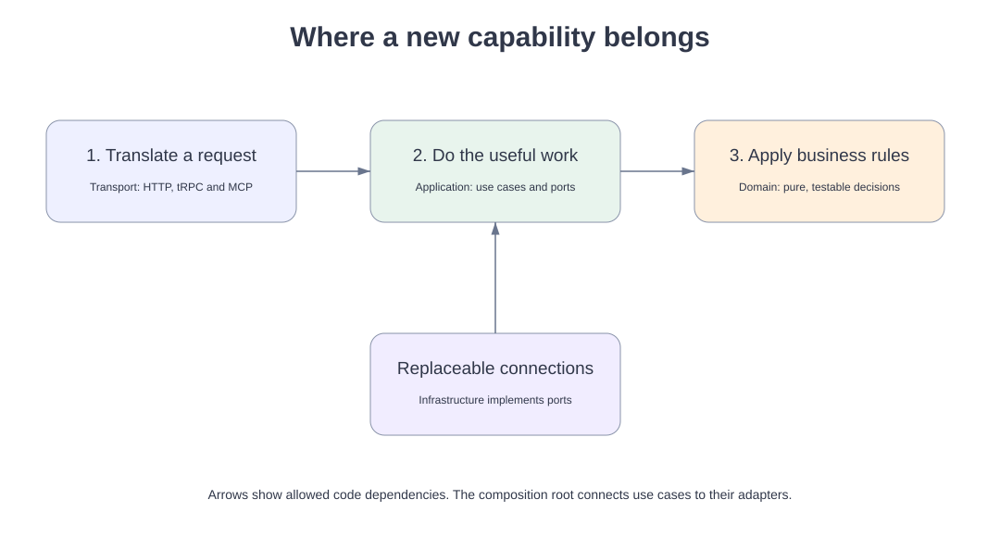

# Add a capability with Claude

Start with the reviewed product brief: who needs what outcome, what data belongs to them, and what success looks like. W00 does not choose a business domain.

1. Create a task branch. Write one acceptance example in plain language.
2. Put pure rules in `apps/api/src/modules/<name>/domain`. No network, React or database imports.
3. Put the use case and its storage/integration interfaces in `application`.
4. Implement those interfaces in `infrastructure`. Wire them in the composition root.
5. Add Zod request and response schemas to contracts. Derive the actor from verified authentication; never trust a submitted owner ID.
6. Add thin transport handlers and a browser feature. The web may import an erased tRPC router type, never server code.
7. Add a migration if the data changes. Include least-privilege grants, RLS and two-user denial tests.
8. Verify the rule, boundary, full journey and failure path. Let the learner approve the local result.

Shared code is intentionally small. Do not introduce a utils folder as a substitute for ownership. Browser work belongs in `apps/web/src/features/<capability>`, with only application chrome and semantic primitives in `ui`.

A replacement Supabase adapter must implement the same application port and pass the same ownership tests. Keep retries bounded and only retry safe reads automatically. Profile upsert is idempotent per authenticated actor. File upload refuses duplicate names; it never silently overwrites. Future money/access mutations require persistent idempotency keys and transaction tests.

No queue is necessary for the baseline. When the first use case needs durable work, define its job port in that module; do not rely on request-lifetime background execution for critical work.
